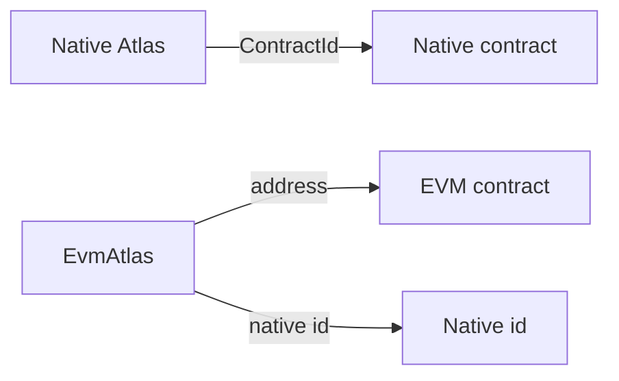

# On DuskEVM

## Why this exists

Contracts on Dusk run in two places. Native contracts call the directory on [Deploy](./deploy). A contract on DuskEVM cannot call that directory. It needs a directory on its own chain.

That directory answers the same kind of question: which contract does this name mean right now? On DuskEVM the answer is usually an EVM address, because that is where the contract lives.

Some names mean a native contract. A message can cross from native Dusk, and the contract that receives it has to recognise who sent it. The directory stores that native id under a name. You write the names for this chain, and you keep them up to date yourself.

The guardian rules match [Guardian](./guardian), with a warden when a name change should wait. The sources are in the [Atlas repository](https://github.com/Nocturne-Standards/atlas) under `evm/`.

## One directory per chain

`EvmAtlas` is the directory for one EVM chain. The constructor takes that chain id. Deploying the same bytecode on another chain fails.

A name is 1 to 32 bytes, written at the start of a 32-byte word. The rest of the word is zeros. The name is not hashed.

## What a name points at

Each name stores a kind and 32 bytes. The kind says what those bytes are.

| Kind | What the 32 bytes are |
|---|---|
| `0` | No entry. `resolve` returns this for a name that has never been written. The bytes are zero. |
| `1` | An EVM address, in the last 20 bytes. The first 12 bytes are zero. The zero address is refused. |
| `2` | A native contract id, all 32 bytes. This is a contract on native Dusk. The all-zero id is refused. |

Kind 1 is the usual record: the name means a contract on this chain. Kind 2 means the name is a contract on native Dusk, and the 32 bytes are that contract's id.

## Reading a name

`resolve(name)` returns the kind and the bytes together. Kind 0 with zero bytes means the name is empty.

`resolveAddress` returns the EVM address when the kind is 1. `resolveNativeId` returns the native contract id when the kind is 2. A missing name fails both calls. So does a name stored as the other kind.

## Recognising a native caller

On a message that crossed from native Dusk, `msg.sender` is the messenger contract. The native contract that sent the message is `xDomainMessageSender()`.

`unaliasedSender(name)` turns a kind 2 entry into that same kind of address. It loads the stored 32-byte id and returns the last 20 bytes of `keccak256` of those bytes. Dusk's SDK names that calculation `duskContractIdToEvmAddress`. Compare `unaliasedSender(name)` with `xDomainMessageSender()`. A match means the message came from the native contract stored under that name.

## Who may change the list

The guardian is one address. The directory checks `msg.sender` against it.

| Call | Who | When it applies |
|---|---|---|
| `initGuardian` | Deployer, once | In that call. Sets the guardian and the first delay. |
| `setService` | Guardian | In that call. |
| `setGuardian`, `setTimelock` | Guardian | After the delay. They share one pending slot. |
| `acceptGuardian` | The account named by a pending guardian change | Required before that change can apply. |
| `cancelPending` | Current guardian | In that call, until the change has been applied. |
| `executePending` | Anyone | Once `executeAt` has passed. |

The longest delay is 3,888,000 blocks, about 90 days when blocks are 2 seconds apart.

Writing the same kind and the same bytes again changes nothing. A different kind, or different bytes, updates the name.

## Adding a wait

To make a name change wait, put `EvmWarden` in the guardian seat.

Deploy the directory first. Deploy the warden with that directory's address, the scheduler address, and the wait. Then call `initGuardian` with the warden address. From then on, the warden is the guardian.

The scheduler asks the warden to queue a name change. The warden waits, then writes the new value. The directory accepts the write because the warden is the guardian.

The same scheduler can queue a new guardian or a new delay. Those wait on the warden, then wait again on the directory. If the warden itself is the account taking over, the scheduler calls `acceptAtlasGuardian` and the warden submits `acceptGuardian`.
