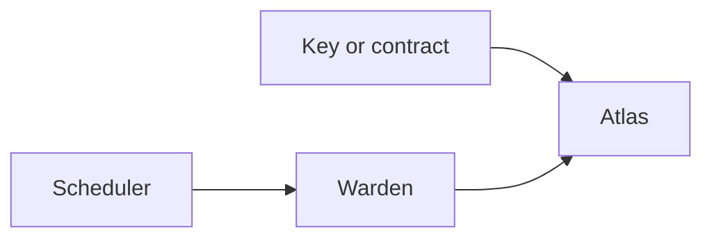

# Guardian

The guardian is the only account that can change the directory. It is set on the Atlas contract itself, by `init_guardian` and later by `set_guardian`. Replacing it waits `timelock_blocks` before it takes effect, and the incoming guardian has to call `accept_guardian`. A mistyped key, or a contract that never calls `accept_guardian`, never takes the slot. The current guardian can cancel that pending change.

Atlas does not call the guardian. A contract guardian is trusted for whatever it checks before it calls in.

## A key

A key guardian calls the directory directly. The call stack under Atlas is empty, or it contains only the genesis transfer contract that carries a Moonlight transaction, and `public_sender` is that key. A deeper stack means some other contract is using the key, and the directory rejects it.

While the guardian is a key, `set_service` applies in that call. [Deploy](./deploy) and [Integrate](./integrate) use this case.

This direct-call rule is what atlas 0.5.0 and later check. Atlas 0.4.1, which is an older testnet deployment, checks only that `caller` is the transfer contract. The repository's `docs/security-model.md` records what that older check still allows.

## A contract

A contract guardian calls the directory itself. Atlas accepts the call when `caller` is the stored contract id. `public_sender` is ignored. Quorum, allowlists, and any extra wait live in that contract. The directory follows the call once `caller` matches.

## A warden

If a name change should wait, install a warden contract as the guardian. The directory still has one guardian slot. The warden is the account in that slot. A key or an ordinary contract guardian calls Atlas itself, and `set_service` applies in that call. With a warden, the scheduler asks the warden to wait, and the warden is what Atlas sees.

The warden has its own caller, the scheduler. You choose the scheduler when the warden is created. That account is allowed to queue a name change, to change the warden's delay, and to start a guardian or delay change on the directory. Replacing the scheduler waits the warden delay, and the new scheduler has to accept before the change applies. The scheduler is the account that operates the warden. Atlas only ever sees the warden.

Knot is one scheduler. A Knot group agrees, and the warden is what holds the change. [Warden](/v1/knot/warden) is that contract. The warden does not check the signatures. Knot does.

A queued name change waits `delay_blocks` on the warden. When the wait is over, anyone can execute it. The warden then calls `set_service`, and the directory writes the new id in that call.

`set_timelock` and `cancel_pending` are forwarded to the directory in the same transaction. The directory then applies its own timelock to a delay change. A cancel takes effect immediately.

Changing the guardian waits twice. The warden holds it for `delay_blocks`, then the directory holds it for `timelock_blocks`, and the incoming guardian calls `accept_guardian`.

The warden also keeps the directory delay at least as long as its own delay (`timelock_blocks >= delay_blocks`). The directory delay is the wait before a new guardian takes over. The warden delay is the wait before a name moves. If the takeover were the shorter of the two, the wait in front of a name change would not be the wait you had configured: a new guardian could move names on its own schedule. The warden can read both numbers, so it refuses a directory timelock below its delay and it refuses to raise its own delay above the directory timelock. Raise the directory timelock first when both need to go up. Choose the first pair that way at init as well. The directory has no view of the warden's delay, so the comparison lives on the warden. `EvmWarden` in the [Atlas repository](https://github.com/Nocturne-Standards/atlas) and `knot-warden` in Knot both enforce it.
