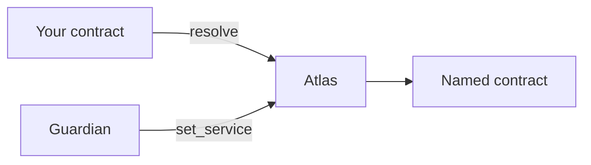

# Atlas

Atlas is a directory you deploy for one project. Other contracts keep its id and ask it, by name, which contract to call right now. One guardian account can move a name, hand the directory to a new guardian, or change how long that handoff waits.

Another project deploys its own directory. Many of these lists exist on the chain at the same time. A contract follows only the directory whose id it was built with.

**Status:** testnet · not audited. You deploy the directory yourself. The versions in the source tree are listed on this page.

Your contract stores the directory's id and asks `resolve` for a name. The guardian is the only account that can point that name at a different contract. A later move of that name is picked up without deploying the caller again. Pointing the caller at a different directory means building it again and deploying that new build.

## What you can do with it

| You want to | Read |
|---|---|
| Deploy a directory and register one name | [Deploy](./deploy) |
| Point one contract at a name, then replace that contract | [Integrate](./integrate) |
| Use a key, a contract, or a warden as the guardian | [Guardian](./guardian) |
| Run a directory on DuskEVM | [On DuskEVM](./evm) |
| Look up a call, a limit, or a crate version | [Reference](./reference) |

## Source

The repository is [Nocturne-Standards/atlas](https://github.com/Nocturne-Standards/atlas).

Depend on the published crates:

- [`nocturne-atlas-encoding`](https://crates.io/crates/nocturne-atlas-encoding) 0.5.0, the call and event bytes
- [`nocturne-atlas-event-decoder`](https://crates.io/crates/nocturne-atlas-event-decoder) 0.3.1, the host decoder

`nocturne-atlas` 0.6.0 is the native directory. It is `atlas.wasm`, built from the repository with `make release-wasm`. It is not a crate to depend on. `nocturne-atlas-test-proxy` 0.3.0 is a test fixture and stays out of deployments.

[Deployments](/v1/deployments/) explains the difference between the directory you deploy and a lab instance someone else is running.

## Versions in the source tree

| Package | Version | What it is |
|---|---|---|
| `nocturne-atlas` | 0.6.0 | `atlas.wasm`, the native directory. Not published to crates.io. |
| `nocturne-atlas-encoding` | 0.5.0 | Call and event bytes. Published. `pending_cancelled` carries `execute_at`. |
| `nocturne-atlas-event-decoder` | 0.3.1 | Host decoder. Published. Cancel records from before 0.6.0 still decode. |
| `nocturne-atlas-test-proxy` | 0.3.0 | Test fixture. Not for deployment. |

A git tag names one commit, and that commit carries these versions together with the `EvmAtlas` and `EvmWarden` sources. The native deploy artifact is the `atlas.wasm` hash printed by `make release-wasm`.
