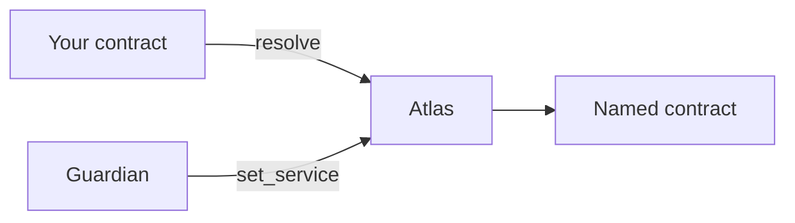
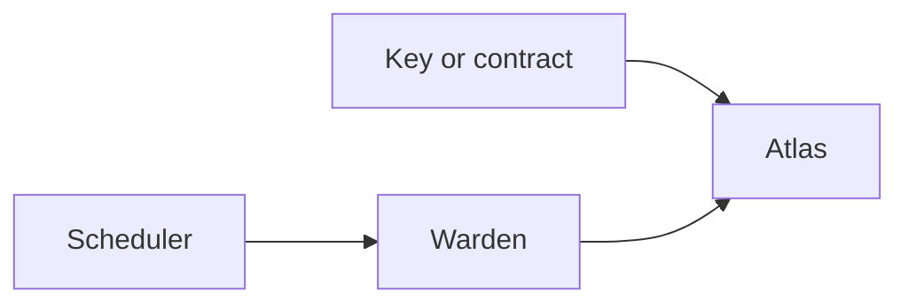
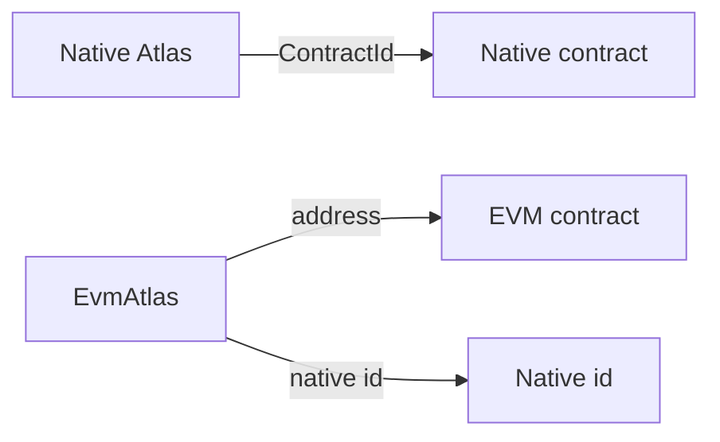

# Atlas

Atlas is a directory you deploy for one project. Other contracts keep its id and ask it, by name, which contract to call right now. One guardian account can move a name, hand the directory to a new guardian, or change how long that handoff waits.

**Status:** testnet · not audited. You deploy the directory yourself. The versions in the source tree are listed on this page.

Your contract stores the directory's id and asks `resolve` for a name. The guardian is the only account that can point that name at a different contract.

## What a deployment stores

A name points at one value. On native Dusk that value is a `ContractId`. The name is 1 to 64 bytes, compared as raw bytes, so `Vault` and `vault` are different names.

Beside the map, the directory keeps three pieces of authority state. The guardian is either a BLS public key or one contract. `timelock_blocks` is how many blocks a guardian change or a delay change must wait. One pending change holds whichever of those two is in progress, so you finish or cancel it before scheduling the other. Moving a name does not use that slot.

Anyone can read the directory. `resolve` returns the current value for a name. `guardian`, `timelock_blocks`, `pending`, and `pending_accepted` return the authority state. A consumer stores the directory id in its own build and calls `resolve` when it needs the current contract, so a later move of that name is picked up without redeploying the consumer.

## Calls

| Call | Who | When it applies |
|---|---|---|
| `init_guardian` | Deploy owner, once | In that call. Sets the guardian and the first delay. |
| `set_service` | Guardian | In that call. |
| `set_guardian`, `set_timelock` | Guardian | After `timelock_blocks`. They share the one pending slot. |
| `accept_guardian` | The account named by a pending guardian change | Required before that change can apply. If the delay has already passed, this call applies it. |
| `cancel_pending` | Current guardian | In that call, for as long as the change has not been applied. |
| `execute_pending` | Anyone | At `execute_at` or any block after it. |
| `resolve`, `guardian`, `timelock_blocks`, `pending`, `pending_accepted` | Anyone | Read. |

`set_service` refuses an empty name, a name longer than 64 bytes, and the all-zero id. From atlas 0.6.0 it also refuses to write an id that is already stored under that name, and it leaves the entry as it was. A different id under the same name updates the entry and emits `service_updated`. On DuskEVM, `setService` does the same for a locator: the same kind and data revert `Unchanged` and emit nothing, while a different kind or different data updates the name and emits `ServiceSet`.

With a delay of 0, a delay change is applied in the same call. A guardian change still waits for `accept_guardian`, which is the check that the new account can actually send a transaction to the directory. A mistyped key, or a contract that never calls `accept_guardian`, never takes the slot, and the current guardian can cancel it.

Native delays cap at 777,600 blocks, about 90 days if blocks are 10 seconds apart.

## The guardian

A key guardian calls the directory directly. The call stack under Atlas is empty, or it contains only the genesis transfer contract that carries a Moonlight transaction, and `public_sender` is that key. A deeper stack means some other contract is using the key, and the directory rejects it.

A contract guardian calls the directory itself. Atlas accepts the call when `caller` is the stored contract id. Quorum, allowlists, and any extra wait live in that contract. The directory follows the call once `caller` matches, and it never calls back into the guardian.

## Adding a wait

If a name change should wait, install a warden contract as the guardian. The directory still has one guardian slot. The warden is the account in that slot. A key or an ordinary contract guardian calls Atlas itself, and `set_service` applies in that call. With a warden, the scheduler asks the warden to wait, and the warden is what Atlas sees.

The warden has its own caller, the scheduler. You choose the scheduler when the warden is created. That account is allowed to queue a name change, to change the warden's delay, and to start a guardian or delay change on the directory. Replacing the scheduler waits the warden delay, and the new scheduler has to accept before the change applies. The scheduler is the account that operates the warden. Atlas only ever sees the warden.

A queued name change waits `delay_blocks` on the warden. When the wait is over, anyone can execute it. The warden then calls `set_service`, and the directory writes the new id in that call.

`set_timelock` and `cancel_pending` are forwarded to the directory in the same transaction. The directory then applies its own timelock to a delay change. A cancel takes effect immediately.

Changing the guardian waits twice. The warden holds it for `delay_blocks`, then the directory holds it for `timelock_blocks`, and the incoming guardian calls `accept_guardian`.

The warden also keeps the directory delay at least as long as its own delay (`timelock_blocks >= delay_blocks`). The directory delay is the wait before a new guardian takes over. The warden delay is the wait before a name moves. If the takeover were the shorter of the two, the wait in front of a name change would not be the wait you had configured: a new guardian could move names on its own schedule. The warden can read both numbers, so it refuses a directory timelock below its delay and it refuses to raise its own delay above the directory timelock. Raise the directory timelock first when both need to go up. Choose the first pair that way at init as well. The directory has no view of the warden's delay, so the comparison lives on the warden. `EvmWarden` in the Atlas repository and `knot-warden` in Knot both enforce it.

## On DuskEVM

A native Atlas and an `EvmAtlas` are two deployments. Each has its own id, its own guardian, and its own names. Nothing copies a change from one to the other. You initialise each of them yourself.

What kind 2 holds is a native contract id written into the EVM directory, so a contract on DuskEVM can be told which native contract a name means. The native directory has no entry for that write.

`EvmAtlas` is the directory for one EVM chain. The constructor takes the chain id and reverts if it is deployed anywhere else, so the same bytecode cannot be replayed onto a different chain.

A name is a `bytes32`: raw UTF-8, left-aligned, zero-padded, with no hash. The deploy script accepts 1 to 32 bytes. The value under that name is a locator, a kind plus 32 bytes, because an EVM address and a native contract id are different widths.

| Kind | Meaning | `data` |
|---|---|---|
| `1` | EVM address | The address in the low 20 bytes. The top 12 bytes are zero. `address(0)` is rejected. |
| `2` | Native contract id | The full 32-byte id. The all-zero id is rejected. |

`resolve(name)` returns that pair. A missing name comes back as kind 0 and empty data. `resolveAddress` returns the address when the kind is 1, and `resolveNativeId` returns the 32-byte id when the kind is 2. Either call reverts if the name is missing or the kind is the other one.

`unaliasedSender(name)` is for the native-id kind. It returns the last 20 bytes of `keccak256` of that id, which is the EVM address Dusk's SDK derives for the native contract (`duskContractIdToEvmAddress`). On a cross-domain message, compare it with `xDomainMessageSender()`. `msg.sender` on that path is the messenger contract, not the native caller.

The guardian on `EvmAtlas` is one address, and the check is `msg.sender == guardian`. The call table matches the native one: `initGuardian` once by the deployer, `setService` immediately, `setGuardian` and `setTimelock` sharing one slot, `acceptGuardian` from the incoming guardian, `cancelPending` by the current guardian, and `executePending` by anyone once `executeAt` has passed. The cap is 3,888,000 blocks, about 90 days at a 2 second block.

`EvmWarden` becomes the guardian by being the address you pass to `initGuardian`. Deploy the directory first. Deploy the warden with that directory address, the scheduler address, and `delayBlocks`. Then call `initGuardian(warden, timelock)` on the directory. From that transaction on, the warden contract is the guardian. Its scheduler calls `scheduleService`, the warden waits, and `executeService` calls `setService` on the directory. The directory accepts the call because the warden's address is `guardian`.

The same scheduler can queue a new directory guardian or a new directory timelock. Those go through the warden delay and then the directory timelock. If the warden itself is the account taking over the directory, the scheduler calls `acceptAtlasGuardian` and the warden submits `acceptGuardian`. `setTimelock` and a directory cancel are forwarded in the transaction that asks for them.

## Integrating

Deploy a directory, initialise it once, and give every consumer that directory's id.

On native Dusk, deploy `atlas.wasm` and call `init_guardian` with the guardian you want to keep and the delay you want to start from. Put that deployment's `ContractId` into each consumer at build time, and call `resolve(name)` at runtime for the contract behind a name. The call and event layouts are the `nocturne-atlas-encoding` package in the Atlas repository. `nocturne-atlas-event-decoder` turns the events back into values for an indexer.

On DuskEVM, deploy `EvmAtlas` with the chain id and call `initGuardian`. For a key guardian, pass that address. For a wait on name changes, deploy `EvmWarden` against this directory and pass the warden address instead. Consumers then call `resolve`, `resolveAddress`, or `resolveNativeId` on the directory address they were configured with.

Before you pin an id, read `guardian` and `timelock_blocks` on it, and read `pending` so you know whether a handoff is already queued. When the guardian is a warden, read the warden's directory pointer and check it is this same deployment. The id you pin is the directory you deployed. [Deployments](/v1/deployments/) explains where versions live, and where an operated product such as Vigil records the release its app uses.

`nocturne-atlas-test-proxy` is a test fixture in the same repository. It forwards whatever it is asked to forward, so it stays out of real deployments.

## Versions in the source tree

| Package | Version | What it is |
|---|---|---|
| `nocturne-atlas` | 0.6.0 | `atlas.wasm`, the native directory |
| `nocturne-atlas-encoding` | 0.5.0 | Call and event bytes. `pending_cancelled` carries `execute_at`. |
| `nocturne-atlas-event-decoder` | 0.3.0 | Host decoder. Cancel records from before 0.6.0 still decode. |
| `nocturne-atlas-test-proxy` | 0.3.0 | Test fixture |

A git tag names one commit, and that commit carries these versions together with the `EvmAtlas` and `EvmWarden` sources. The native deploy artifact is the `atlas.wasm` hash printed by `make release-wasm`.
