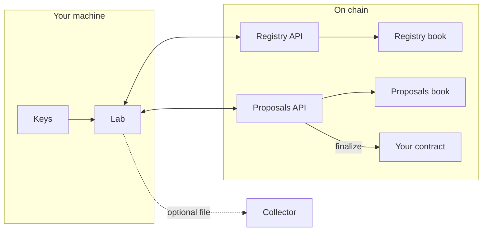

# Architecture

**Status:** testnet only, not audited yet.

Follow one signed action from a laptop to the book. The crates are that path,
split so the book can stay when the API is replaced.

The book checks `abi::caller()` against the contract Atlas resolves for
`knot-registry` or `knot-proposals`. Point the name at a new API, call
`init_data` with the same book, and the accounts or proposals are still there.
[Warden](./warden) is not split that way: replacing it is a new contract id.

## Crates

| Crate | License | On that path |
|---|---|---|
| [`knot-tool`](https://github.com/Nocturne-Standards/knot/tree/main/crates/knot-tool) | Apache-2.0 | The Lab. Holds keys. Sends transactions |
| [`knot-encoding`](https://github.com/Nocturne-Standards/knot/tree/main/crates/knot-encoding) | Apache-2.0 | The bytes the Lab and the APIs both hash |
| [`knot-registry`](https://github.com/Nocturne-Standards/knot/tree/main/crates/knot-registry) | Apache-2.0 | Group API |
| [`knot-registry-data`](https://github.com/Nocturne-Standards/knot/tree/main/crates/knot-registry-data) | Apache-2.0 | Account book |
| [`knot-proposals`](https://github.com/Nocturne-Standards/knot/tree/main/crates/knot-proposals) | Apache-2.0 | Proposal API |
| [`knot-proposals-data`](https://github.com/Nocturne-Standards/knot/tree/main/crates/knot-proposals-data) | Apache-2.0 | Proposal book |
| [`knot-warden`](https://github.com/Nocturne-Standards/knot/tree/main/crates/knot-warden) | Apache-2.0 | Wait before an Atlas `set_service` |
| [`knot-warden-encoding`](https://github.com/Nocturne-Standards/knot/tree/main/crates/knot-warden-encoding) | Apache-2.0 | Warden arguments and events |
| [`knot-collector`](https://github.com/Nocturne-Standards/knot/tree/main/crates/knot-collector) | AGPL-3.0-only | Optional mailbox for the proposal file |

Warden's two crates are their own Cargo workspace, because they depend on a
sibling Atlas checkout. Everything else is the root workspace. Keys stay in
the Lab. The collector never sees them.

| Piece | Holds keys? | Sends transactions? |
|---|---|---|
| Lab | Yes, on that machine | Yes |
| Collector | No | No |
| APIs and books | No | They are the contracts |
| Warden | No | It calls Atlas `set_service` after its own wait |

## Lab

`knot-tool serve` refuses to start until you pick a mode.

| Mode | Chain |
|---|---|
| `mock` | In-memory ledger. Real local signatures. No broadcast |
| `testnet` | DuskDS testnet. Reads and gas-paying writes |

It listens on loopback, default `127.0.0.1:8877`. The browser gets a session
cookie from a one-shot link and never receives a secret key.

Writes shell out to `rusk-wallet` (`RUSK_WALLET_PWD`). Reads are raw binary
HTTP to the node. Do not hex-encode those bodies.

Method names: [Contracts](./contracts). Cold start: [Run locally](./run-locally).
