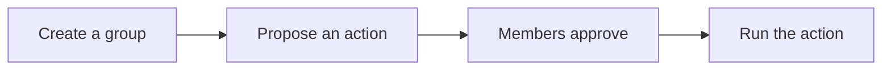

# Concepts

**Status:** testnet only, not audited yet.

Read this when you want the idea before the method names. The jobs themselves
are on [Use cases](./use-cases). The calls are on [Contracts](./contracts).

Knot is one idea: **enough of the right people signed the same action**.

## Prove vs Coord

Two ways people talk about "is this quorum good enough?"

- **Prove** - the chain checks again for itself: are these signers current
  members? Is the threshold met? Do the signatures verify? Your inputs are
  evidence; the contract does not take your word for it.
- **Coord** - an off-chain tool says "quorum met" and the chain trusts that
  without an equal check.

Knot's contracts are **Prove**. The Lab helps you sign; it is not the final
yes/no for on-chain writes. More detail: [Security](./security).

## Registry account

A **registry account** is a named group: a list of member public keys and a
threshold (for example 2-of-3).

The registry answers one question: *did enough current members sign this
message?* It does **not** hold money. For most messages it also does **not**
decide what the message means - your app must put its own domain label, action,
and replay protection (nonce or similar) into those bytes.

Anyone can create an account and name other people's keys as members. That does
not give the creator control of those keys. After create, read the account back
(and the returned id) before you wire it into another contract - do not guess
the id.

To change members or threshold later, current members sign a
`change_account` message. That path has its own digest format and includes the
on-chain nonce, so replays of old change signatures fail.

## Quorum check

| Style | What happens on-chain |
|---|---|
| One-by-one | `verify_quorum` checks each signature separately. Proposals uses this |
| Aggregate | `verify_quorum_aggregate` checks one combined signature |

A free read over the node HTTP API can say false for a secure signature that
a real transaction accepts. The query VM uses the pre-hardfork verify policy.
Send the transaction and read the account back.

## Proposals

A **proposal** is a structured action: which contract to call, which function,
which arguments, and a deadline. Members approve by signing a digest built from
those fields (plus chain and contract context in v3).

Anyone can open a proposal for the bound group. A proposal for any other
group is rejected. Anyone can pass approvals around, or call finalize once
enough approvals exist. That lets a funded helper pay gas while members hold
no DUSK.

Execution is bound to **one** registry account. The owner sets it with
`set_authorized_account`. Each set bumps a generation, including setting the
same account again. Finalize and execute accept only proposals opened at the
current generation, and only if the signed digest names this proposals
contract. A second proposals contract pointed at the same book cannot replay
the old signatures.

Approve stores the signature. It does not re-check the generation. Finalize is
the check.

On finalize, the proposals contract runs the action via `call_raw` (a low-level
call into the target contract). The **target** must check that the caller is the
proposals contract - Knot does not keep a list of allowed targets.

Any human-readable summary attached off-chain is display-only. Sign from the
canonical fields, not from the summary text.

## Delay

After the group has signed, the action can still wait. Each registry account
has `timelock_blocks` (default **0**).

| | What happens |
|---|---|
| Delay 0 | Membership changes and `finalize` apply in the same call |
| Delay above 0 | Membership sits in `pending` until `execute_pending`. Proposals sit `Queued` until `execute` after `execute_at` |
| Deadline | Must run **by** that block. Delay is must **not** run before |
| Wait would pass the deadline | Finalize refuses. Pick a later deadline |
| Cancel | Needs a new quorum, the same threshold. No extra wait. It helps only while enough honest keys remain. Open proposals expire at the deadline instead |

The Lab's **Delay (blocks)** field sets the registry account delay. Warden
has `delay_blocks`. Atlas has `timelock_blocks`.

## Atlas

[Atlas](/v1/atlas/) maps a service name to a contract id. [Warden](./warden)
is the contract placed in Atlas's guardian slot when a service change must
wait.

Atlas waits `timelock_blocks` on `set_guardian` and `set_timelock`. Those two
calls share one pending slot. With delay 0, a delay change applies in the
same call. A guardian change waits for `accept_guardian`. Warden queues
`set_guardian` for `delay_blocks` first, so that change waits the warden
delay and then the Atlas timelock. `set_timelock` goes to Atlas in the same
transaction, and Atlas then waits its own timelock.

The registry book and the proposals book call Atlas `resolve` before a write.
The Atlas id is fixed when the book is built (`ATLAS_PIN_HEX`). A quorum
check reads the book. `set_service` applies in the call. When Warden is the
guardian, Warden's `delay_blocks` is the wait in front of that call.

## Signing gate

Before you sign, the Lab recomputes the digest from the proposal fields and
refuses if it does not match what you were asked to sign
(`gate_blob_for_signing` / `recompute_and_verify` in `knot-encoding`).

That gate is what stops blind signing and a lying collector from tricking you
into the wrong intent.

Co-signers can also compare a full fingerprint of the digest (hex, or a 24-word
mnemonic of the full hash). Never truncate the hash for compare.

## Key ceremony

`verify_quorum` checks each signature on its own against the member's own key.
`verify_quorum_aggregate` checks one combined signature with
`abi::verify_bls_multisig`, which scales each key by a hash of the key. Knot
does not ask members for a separate proof of key ownership.

## Blobs

A **ProposalBlob** is a portable file: the proposal fields plus any partial
signatures collected so far. You can pass that file around yourself (chat,
USB, your own channel).

An optional **collector** is a small HTTP service that stores those blobs so
people do not have to email JSON. It never holds keys, never signs, and never
submits chain transactions. See [Collector](./collector).
