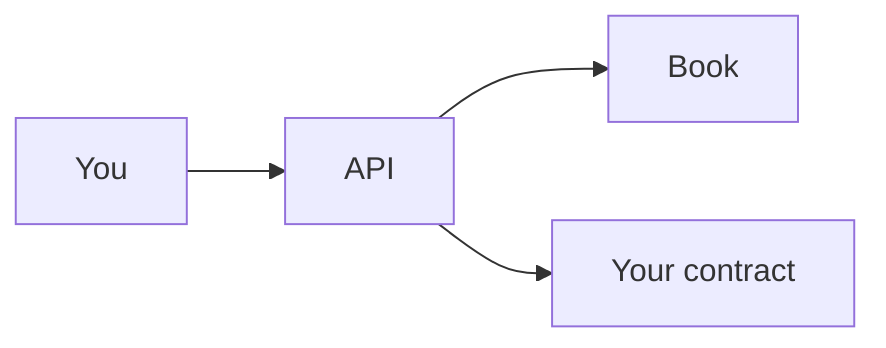

# Contracts

**Status:** testnet only, not audited yet.

You are about to call Knot from your own contract or tool. Call the API.
The book is storage, and it only accepts the API that Atlas resolves for that
service name.

Live ids: [Deployments](/v1/deployments/). Versions and redeploys:
[versioning.md](https://github.com/Nocturne-Standards/knot/blob/main/docs/versioning.md).



Deploy the book and the API, then the owner calls `init_data` with the book
id. Same id may be retried. A different book panics. That call is the owner
key itself: a contract inside the owner's transaction cannot make it.

## Registry

The registry answers one question: did enough **current** members sign this
message? It does not hold funds.

Atlas `knot-registry` is the API id.

| Method | Who | Effect |
|---|---|---|
| `init_data` | Owner, direct, once | Points the API at its book |
| `create_account` | Anyone | New group. Returns the id |
| `account` / `next_account_id` | Anyone | Read |
| `verify_quorum` | Anyone | Checks each signature |
| `verify_quorum_aggregate` | Anyone | Checks one combined signature |
| `change_account` | Quorum of current members | New members and threshold |
| `set_timelock` | Quorum of current members | This group's delay |
| `cancel_pending` | Quorum | Drops a scheduled change now |
| `execute_pending` | Anyone, after the wait | Applies the scheduled change |

For a message you invented, put your own domain and a nonce in the bytes.
`change_account` already binds the account nonce. After `create_account`,
read the account back before you store the id.

`diagnose_quorum` is not on-chain. Keeping it out of the contract means there
is one WASM build, and the bytecode tested is the bytecode deployed.

| Event | When |
|---|---|
| `data_set` | First `init_data` |
| `account_created` | `create_account` |
| `pending_scheduled` | A delayed membership or timelock change |
| `account_changed` | The new members are stored |
| `timelock_set` | The new delay is stored |
| `pending_cancelled` | `cancel_pending` |

Delay 0 emits the applied event only, not also `pending_scheduled`. The book
does not emit. The payload is the value that was written.

## Proposals

A proposal is one call: target, function, arguments, deadline. The API asks
the registry who the members are.

Atlas `knot-proposals` is the API id. After `init_data`, the owner calls
`init_registry` with the registry API, then `set_authorized_account` with the
one group allowed to execute. Each `set_authorized_account` bumps
`auth_generation`, including setting the same account again.

| Method | Who | Effect |
|---|---|---|
| `init_data` | Owner, direct, once | Points the API at its book |
| `init_registry` | Owner, direct | Registry API. Bumps epoch |
| `set_authorized_account` | Owner, direct | The one group that may propose, finalize, or execute |
| `set_proposal_ttl` / `set_tombstone` | Owner, direct | Config |
| `propose` | Anyone, for the bound group | Other groups are rejected |
| `approve` | A member | Stores one signature. Does not check generation |
| `finalize` | Anyone, once threshold is met | Runs now, or queues |
| `execute` | Anyone, after `execute_at` | Runs a queued proposal |
| `cancel` | Current members | Drops a queued proposal now |
| `prune` | Anyone | `prune(0)` removes nothing. Each call reads a bounded page |
| `proposal` / `status` / `epoch` | Anyone | Read |

Finalize keeps approvals from members still on the committee, then checks the
threshold. It also recomputes the digest with **this** API's contract id.
Signatures opened on a different proposals contract do not finalize here.

| Event | Carries |
|---|---|
| `proposal_created` | Id, digest, account, deadline, target, function, arguments |
| `proposal_approved` | Id, digest, signer, signature |
| `proposal_finalized` / `proposal_queued` | The call, and `execute_at` when queued |
| `proposal_cancelled` | Id, digest, account |
| `authorized_account_set` | Account and the new generation |
| `pruned` | Proposal ids removed, and digest keys removed |

`prune` still returns how many proposals were removed. A later call can remove
expired digests and emit `pruned` with a return count of 0.

**Deadline** is "by this block". **Delay** is "not before `execute_at`". If
the wait would pass the deadline, finalize refuses.

If your contract is the target, require the caller to be the proposals API:

```rust
if abi::caller() != Some(PROPOSALS_API) {
    panic!("not the proposals contract");
}
```

Use `abi::caller()`, not `public_sender`. Finalize refuses its own contract
and its book as a target. The snippet also lives on [Integrate](./integrate).

A fresh API may `init_data` onto an existing book. There is no separate adopt
step. v2 signatures do not verify under v3.

## Signed bytes

The Lab and both APIs hash the same bytes. The digest is Keccak-256 of a flat
preimage. Full 32 bytes, never truncated.

A proposal (`proposal_digest_v3`), little-endian lengths and integers:

```text
domain          nocturne.knot.multisig.proposal.v3
chain_id        u64
self_id         32 bytes     the proposals API
epoch           u64
committee_id    u64
nonce           u64
target          32 bytes
fn_len          u32
function_name   bytes
args_len        u32
call_args       bytes
deadline        u64
```

Changing members (`change_account_digest_v3`):

```text
domain          nocturne.knot.multisig-registry.change_account.v3
chain_id        u64
self_id         32 bytes     the registry API
account_id      u64
nonce           u64
member_count    u32
member_pks      96 bytes each, in order
threshold       u32
```

| Action | Domain |
|---|---|
| Proposal | `nocturne.knot.multisig.proposal.v3` |
| Change members | `nocturne.knot.multisig-registry.change_account.v3` |
| Set the account delay | `nocturne.knot.multisig-registry.set_timelock.v1` |
| Cancel a pending membership change | `nocturne.knot.multisig-registry.cancel_pending.v1` |
| Cancel a queued proposal | `nocturne.knot.multisig.proposal.cancel.v1` |

Member order is part of the `change_account` digest. Shuffle the list and the
signature is for a different change.

`auth_generation` is not inside the digest. Finalize reads it from the book
and compares it to the generation stored when the proposal was opened.

Feature `call-types` is the shared argument types. Feature `contract-events`
is the event payloads. Layout goldens pin both.

Warden signs nothing. See [Warden](./warden).
