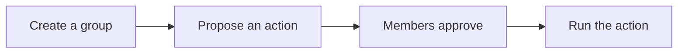

# How it works

**Status:** testnet only, not audited yet.

Enough of the right people signed the same action. That is the whole idea.

## What you can do with it

**Call a contract.** Members sign the description of one call. They do not send it. After enough signatures, Proposals calls your contract. Your contract checks `abi::caller()`.

**Change members.** Current members sign `change_account`. The group's delay decides whether that lands now or waits.

**Pass a signature.** A proposal file can move by hand, or through the optional [Collector](./collector). The collector never holds keys.

**Check a quorum from your own contract.** Any group, not only the one bound to Proposals. See [Integrate](./integrate).

Moving an Atlas service name is a different job. See [Warden](./warden).

## Groups

A group has 1 to 16 distinct member keys and a threshold from 1 up to that size. Anyone can create one. Listing a key does not control that key. Read the group back with the id `create_account` returned.

The registry answers one question: did enough current members sign these bytes? It holds no funds. It does not decide what the bytes mean.

## Checking a quorum

`verify_quorum` checks each signature on its own against that member's key. `verify_quorum_aggregate` checks one combined signature. Proposals uses `verify_quorum`, one signature at a time.

`verify_quorum` checks each signature against the member's own key. `verify_quorum_aggregate` checks one combined signature with `abi::verify_bls_multisig`, which scales each key by a hash of the key. Knot does not ask members for a separate proof of key ownership.

A free read of either check can say `false` for a signature that a real transaction accepts. The query runs under the node's pre-hardfork host-query policy. Don't use it as the test.

## Proposals

One call: a target, a function name (at most 64 bytes), arguments (at most 4096 bytes), and a deadline inside `proposal_ttl` (at most 100,000 blocks).

Anyone can open a proposal for the one bound group. A proposal for any other group is rejected. A member approves by signing the digest. Anyone can finalize once the threshold is met. If the group's delay is above 0, finalize queues the call and anyone can execute it after `execute_at`.

The deployer binds that one group. Finalize refuses Proposals itself and its book as a target. The target must check `abi::caller()`. Knot keeps no allowlist.

## Delays

The Lab field **Delay (blocks)** is the group's `timelock_blocks`. Default 0, and then the change applies in the same call. A deadline is "by this block". A delay is "not before `execute_at`". If the wait would pass the deadline, finalize refuses.

Cancel of a queued proposal or a pending member change needs a new quorum, the same threshold, and it does not start another wait. It helps only while enough honest keys remain. An open proposal has no cancel; it expires at the deadline.

The other two clocks, Warden's `delay_blocks` and Atlas's `timelock_blocks`, are on [Who can change what](./who-can-change-what).

## Signing safely

Before you sign, the Lab recomputes the digest from the fields and refuses a mismatch. Compare the full digest: hex, a 24-word mnemonic of the full hash, or the safety number. Never truncate it.

## Passing files

A proposal blob is the fields plus any partial signatures. You can move that file yourself. The collector stores blobs so people don't have to. See [Collector](./collector).

## The pieces

| Piece | Licence | Holds keys? | Sends transactions? |
|---|---|---|---|
| `knot-encoding` | Apache-2.0 | No | No |
| `knot-registry` / `knot-registry-data` | Apache-2.0 | No | No |
| `knot-proposals` / `knot-proposals-data` | Apache-2.0 | No | No |
| `knot-warden` / `knot-warden-encoding` | Apache-2.0 | No | No. They build only next to an Atlas checkout |
| `knot-tool` (the Lab) | Apache-2.0 | Yes, on your machine | Yes, through `rusk-wallet`, which pays gas |
| `knot-collector` | AGPL-3.0-only | No | No |

Contract ids: [Deployments](/v1/deployments/). Method tables: [Reference](./reference).
