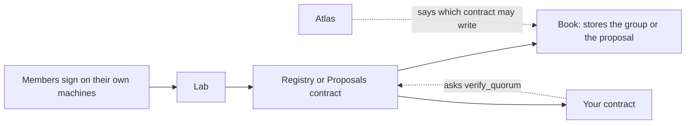

# Knot

You have several keys, and something on Dusk should happen only when enough of them agree. Knot is the check for that. A group lists its members and a threshold, for example 2 of 3. When someone asks for the action, the chain looks at the signatures and decides.

**Status:** testnet · mock · not audited. Knot runs on Dusk testnet, and you can try the Lab in mock mode with no chain at [knot.nocturne-standards.org](https://knot.nocturne-standards.org).

## How one action moves

Each member signs on their own machine. The Lab helps them sign, but it doesn't decide anything. The Registry and Proposals contracts check the signatures again against the group stored on chain. The book is where the group or proposal lives, and it accepts a write only from the contract that Atlas names for it. Your contract either asks the registry "did enough members sign this?" or receives a call from Proposals once a group has approved it.

## Five things to know before you rely on it

1. **You deploy your own copy.** There is no shared Knot that anyone can sign up to. You deploy the Registry and Proposals contracts for your project, fix your Atlas id when you build them, and pick your own groups. Our own products run on our own deployment. Its live ids are on [Deployments](/v1/deployments/).
2. **Who holds the keys.** A group's members control that group. The deployer key sets up the contracts. The Atlas guardian decides which contract may write the groups, which makes it the most powerful role. [Who can change what](./who-can-change-what) lists each key and the delay that applies.
3. **It needs Atlas.** The two books accept writes only from the contract that Atlas names for them, and the Atlas id is fixed when a book is built. A missing `ATLAS_PIN_HEX` fails that build. So a Knot deployment includes an Atlas. Checking a quorum (`verify_quorum`) doesn't call Atlas, but the group data it reads can only have been written through that Atlas check.
4. **Proposals work for one group per deployment.** The deployer picks which group; a proposal for any other group is rejected. Checking a quorum from your own contract works for any group.
5. **Member keys are BLS keys.** They aren't wallet keys. The Lab keeps them in its own keystore. More in [Integrate](./integrate).

## What you can do with it

| You want to | Read |
|---|---|
| Run it on your machine in a few minutes | [Quickstart](./quickstart) |
| Understand groups, proposals and delays | [How it works](./how-it-works) |
| Ask Knot from your own contract | [Integrate](./integrate) |
| See who holds which power, and which delay applies | [Who can change what](./who-can-change-what) |
| Look up a method, event or signed byte layout | [Reference](./reference) |
| See what is and isn't covered | [Security and limits](./security) |
| Check a Knot group from a Solidity contract | [On DuskEVM](./evm) (deployed on DuskEVM testnet) |

## The pieces

| Piece | You call it? | What it keeps |
|---|---|---|
| [Registry](https://github.com/Nocturne-Standards/knot/tree/main/crates/knot-registry) | Yes | Nothing. It checks signatures against the group |
| [Registry book](https://github.com/Nocturne-Standards/knot/tree/main/crates/knot-registry-data) | No | Members, threshold, delay |
| [Proposals](https://github.com/Nocturne-Standards/knot/tree/main/crates/knot-proposals) | Yes | Nothing. It runs the approved call |
| [Proposals book](https://github.com/Nocturne-Standards/knot/tree/main/crates/knot-proposals-data) | No | Proposals and their digests |
| [Encoding](https://github.com/Nocturne-Standards/knot/tree/main/crates/knot-encoding) | From your own code | The bytes everyone signs |
| [Lab](https://github.com/Nocturne-Standards/knot/tree/main/crates/knot-tool) | On your machine | The keys |
| [Warden](./warden) | Optional | The wait before an Atlas name points at a new contract |
| [Collector](./collector) | Optional | Proposal files. Never keys |

Vigil uses Knot for each vault's signing group. Vigil's own approvals between devices travel through Vigil's own collector, not this one. See [Vigil approvals](/v1/vigil/app/approvals).

Source: [GitHub, Nocturne-Standards/knot](https://github.com/Nocturne-Standards/knot). Contract ids: [Deployments](/v1/deployments/). Most of Knot is Apache-2.0. The collector is AGPL-3.0-only.
