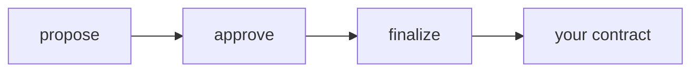

# Use cases

**Status:** testnet only, not audited yet.

Four jobs. Each one is the same idea: enough of the right keys signed, then
the chain does one thing.

## Call your contract

A council wants to release funds, flip a flag, or call some other contract.
Members never send that call themselves. They sign the description of it.

| Step | Who | What is true afterwards |
|---|---|---|
| `propose` | Anyone, for the bound group | Other groups are rejected. The book has the target, function, arguments, and deadline |
| `approve` | A current member | One signature is stored against that digest |
| `finalize` | Anyone, once the threshold is met | The proposals API calls your contract |
| `execute` | Anyone, after the wait | Same call, if the account delay was above 0 |

Your contract checks `abi::caller()` is the proposals API. The human-readable
summary people saw off-chain is not what they signed.
[Contracts](./contracts) has the digest bytes.

## Change members

The same council later replaces a member or raises the threshold. Current
members sign `change_account`. The registry account's `timelock_blocks` decides
whether that lands now or waits.

| Delay | What you see |
|---|---|
| 0 | The new members are stored in the same call |
| Above 0 | The change sits in `pending` until anyone calls `execute_pending` |
| Cancel | A new quorum, the same threshold, not another wait. Honest keys must still reach that threshold |

Read the account back after `create_account`. The id you got is the id you wire
into other contracts.

## Move a service

Atlas has a name, `knot-registry` or anything else, that points at a contract.
Changing that pointer should wait. [Warden](./warden) is the guardian that
makes the wait. The proposal target is the warden, the function is
`schedule_service`, and a later `execute_service` is the transaction that
actually calls Atlas.

The proposal deadline is an expiry. It is not this wait.

## Pass a signature

Each member signs on their own machine. The running total is a file: the
proposal fields plus the partial signatures collected so far. You can hand
that file over any channel you already trust.

A [collector](./collector) is that file on a small HTTP service, so people do
not have to email JSON. It cannot sign, and it cannot submit the transaction.
The signer still recomputes the digest before they sign.
