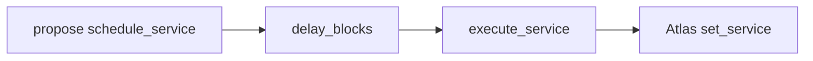

# Warden

**Status:** testnet only, not audited yet.

This page is the wait before an Atlas name points at a different contract.
Warden is the guardian, so `set_service` applies when Warden calls Atlas
after `delay_blocks`. Knot proposals stay a generic executor: the proposal's
target is the warden id, and the function is `schedule_service`.

Live ids: [Deployments](/v1/deployments/). Every method:
[`docs/warden.md`](https://github.com/Nocturne-Standards/knot/blob/main/docs/warden.md).

## Two delays

| Delay | Where | What it covers | Who cannot delete it in one transaction |
|---|---|---|---|
| `delay_blocks` | warden | `schedule_service`, `set_delay`, `set_scheduler`, `set_guardian` | The scheduler |
| `timelock_blocks` | Atlas | `set_guardian`, `set_timelock` | The warden |

A guardian change waits twice: warden queues `set_guardian` for
`delay_blocks`, then Atlas waits `timelock_blocks` before it applies.
`set_timelock` is forwarded to Atlas in the same transaction, and Atlas waits
on it. `set_timelock` and `set_guardian` share Atlas's one pending slot. With
delay 0, a delay change applies in the same call. A guardian change waits
for `accept_guardian`.

Until the guardian wait finishes, the old warden is still the guardian, and
service repoints still wait `delay_blocks`. A service scheduled under the old
delay keeps that `execute_at`.

`init_warden` and Atlas `init_guardian` are the only immediate writes of each
delay. Do not leave either at 0.

## Who may call

| Call | Who |
|---|---|
| `init_warden` | Deploy owner, direct, once |
| `schedule_service`, `set_delay`, `set_scheduler`, cancels, forwards | The scheduler |
| `execute_service`, `execute_admin` | Anyone, after `execute_at` |

An external scheduler must be the key itself, not a contract inside that
key's transaction. A contract scheduler is accepted when `caller` is that
contract. The proposals API qualifies, because finalize's caller is the
proposals API.

Warden is not the committee, not a second directory, and not an open proxy.
A new warden is a new contract id, installed with `set_guardian`.

## What is wired on testnet today

Atlas's guardian is a Warden contract, and that Warden waits 30 blocks before a service change applies. These are lab values. The scheduler is one ordinary key, not a group. The shared Proposals contract has no group bound yet, so a group cannot start a change. Ids are on [Deployments](/v1/deployments/). Who holds which power: [Who can change what](./who-can-change-what).

Warden and its encoding crate build only next to an Atlas checkout.

## Install it

| Step | Call | Direct owner? |
|---|---|---|
| 1 | Registry book + API. Atlas `knot-registry` names the API. `init_data` | Yes |
| 2 | Proposals book + API. `init_data`, `init_registry`, `set_authorized_account` | Yes |
| 3 | `init_warden` with the Atlas id, the proposals API as scheduler, and the service delay | Yes |
| 4 | Atlas `init_guardian` with the warden id and a timelock above 0 | Yes |

Then the council proposes `schedule_service` aimed at the warden. Finalize
only schedules. After `execute_at`, anyone calls `execute_service`. That
transaction calls Atlas `set_service`.

## Events

| Topic | When |
|---|---|
| `atlas_set`, `scheduler_set`, `delay_set` | `init_warden` |
| `service_scheduled` / `service_executed` / `service_cancelled` | A repoint |
| `admin_scheduled` / `admin_cancelled` | Delay or scheduler change |
| `guardian_forwarded`, `timelock_forwarded`, `atlas_cancel_forwarded` | After the Atlas call |

The payload is the value that was written. Atlas still emits its own events
when the directory changes. Subscribe to warden for the wait, and to Atlas
for the directory.
