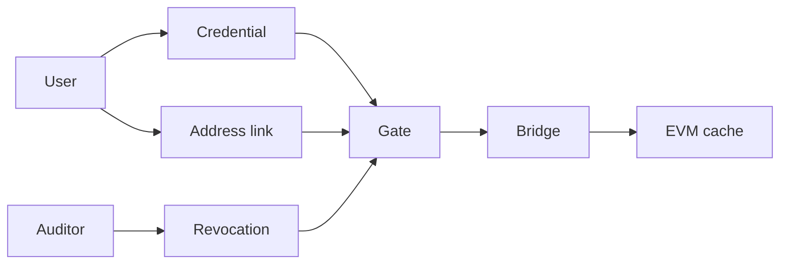

# Architecture

Four contracts on Dusk do the clearance. A fifth step carries the answer to DuskEVM when a product there needs it. Each contract has one job, and the gate is the only one a product has to call.

| Contract | What it keeps |
|---|---|
| Credential | Checks the proof and records the session. |
| Revocation | The sessions an auditor has revoked. |
| Address link | The commitment that binds an EVM address to a session, and whether that link is active. |
| Gate | Asks the other three and answers yes or no. Can send that answer across the bridge. |

## A check

1. The person opens a session by proving the credential.
2. They link an EVM address and prove they hold that key. The registry confirms the link.
3. A product calls the gate with that session.
4. The gate reads the session, then the revocation registry, then the address link when this deployment uses one.
5. Yes means the session is live, it is not revoked, and the link is active.

A product on Dusk stops at step 5. A product on DuskEVM reads the cache the gate filled by sending the same answer across the bridge.

## What crosses the bridge

The bridge carries a clearance result, or a change in the wallet link. It does not carry the credential or the proof. The EVM cache stores the result, the time, and which link it belongs to. The cache accepts the message only from the native gate configured for that deployment.

[Lien's architecture](/v1/lien/architecture) is the credit market on the far side of that cache: the router reads the row before supply or borrow, and a revoke or an expired yes is what makes the position unwindable.

## Who can write

| Action | Who |
|---|---|
| Open a session | The person, by a proof the credential contract accepts |
| Revoke or restore a session | The auditor key |
| Confirm or revoke a wallet link | The person proves the key; the registry records it |
| Send a clearance to DuskEVM | The gate, to the cache it was pointed at |

Issuing a credential and revoking a session are different keys, so a key that can issue cannot by itself silence a revoke.
