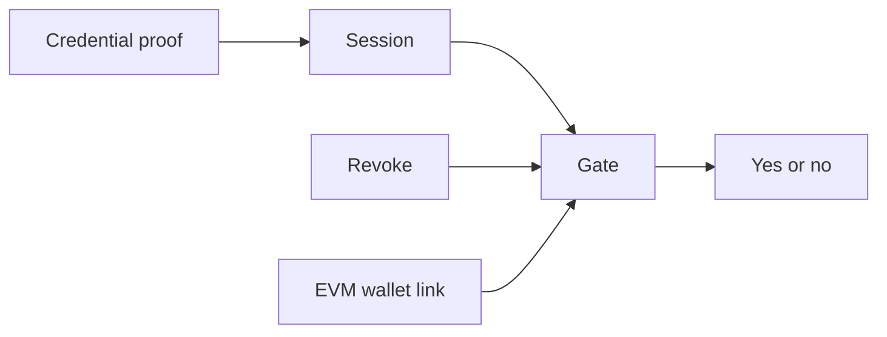

# Concepts

Latch answers one question for the rest of the stack: is this person cleared right now, and which EVM wallet is theirs. The proof stays on Dusk. Other contracts call the gate and read the answer.

## A session

A person presents a proof that they hold a valid credential. The credential contract checks the proof and opens a session. The session is the handle later calls use. The credential itself is not copied onto DuskEVM.

## Revoke

An auditor key can revoke a session, and can clear that revoke. The auditor key is separate from the key that issued the credential. The gate asks the revocation registry on every check, so a revoke applies the next time something asks, including a session whose proof still verifies.

## The wallet link

The address-link registry binds an EVM address to a session. The person requests the link, proves they control that EVM key, and the registry confirms it. The link is stored as a commitment: it binds the address to the session, and the credential stays on Dusk. A revoke on the link closes it.

Until a deployment points the gate at this registry, the gate answers from the session and the revocation list alone. Once it is pointed, an inactive link fails the check.

## The gate

The gate is the contract other products call. It reads the session, the revocation list, and, when configured, the wallet link. The answer is yes only when every configured check passes.

A product on Dusk calls the gate directly. A product on DuskEVM cannot. The gate can send the answer across the bridge, and the EVM cache stores the latest yes or no with the time it arrived. [Lien](/v1/lien/) is the credit market that reads that cache before someone may supply or borrow.

The cache accepts a message only from the native gate it was configured with.
