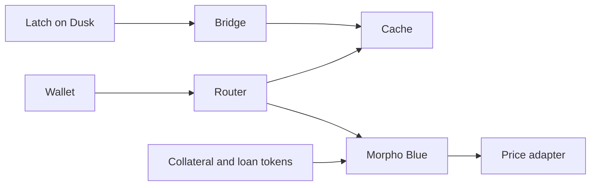

# Architecture

Dusk keeps the credential. DuskEVM runs the credit market and a cache of the latest clearance. The bridge delivers that clearance. Morpho Blue is the market, and the contracts around it are the fence.

## Where each fact lives

| Layer | What it keeps |
|---|---|
| Dusk | The credential, the session, the revocation list, and the link from that session to an EVM wallet. [Latch](/v1/latch/) is this layer. |
| Bridge | A clearance result, or a change in the wallet link. |
| DuskEVM | The cache, the permissioned tokens, the router, the price adapter, and Morpho Blue. |

A supply or a borrow on DuskEVM does not call back to Dusk. It reads the cache. The only fact that crosses the bridge is the clearance, and it arrives with a time.

## A supply or a borrow

1. The person proves clearance on Dusk and links an EVM wallet. [Latch concepts](/v1/latch/concepts) describes that proof and the link.
2. Latch sends the result across the bridge. The cache accepts it only from the native gate it was configured with.
3. The wallet calls the router to supply collateral or to borrow. The router reads the cache. The row has to be a yes, and the time has to sit inside the freshness window.
4. The router forwards the call to Morpho Blue and opens the position in the caller's name.
5. On every token transfer underneath, the collateral token and the loan token check the route on their own.

A revoke, or a yes older than the freshness window, flips the row. The position can then be [unwound](./concepts#revoke-and-unwind).

## The contracts

| Contract | What it does |
|---|---|
| Cache | Stores the latest clearance and its time. Pause and break-glass live here. |
| Router | The entry for supply, collateral, and borrow. Checks the cache, then calls the market in the caller's name. |
| Collateral token and loan token | Move only along the allowlist. |
| Price adapter | The number Morpho reads. On testnet an admin sets it. |
| Morpho Blue | The lending market. [Upstream](https://github.com/morpho-org/morpho-blue), unchanged. |

## Who a token may move to

| From | To |
|---|---|
| A cleared wallet | The market or the router |
| The market, the router, the liquidator, or the sweep address | Each other, or back to a cleared wallet |
| One wallet | Another wallet: refused |

An admin sets the two lists on each token: the infrastructure addresses, and the smaller set a cleared wallet may actually reach. That smaller set is the market and the router. A wallet cannot send collateral straight to the liquidator or the sweep address. Unwind still works, because those infrastructure addresses can send to each other.

The loan token is minted by the mint role. On testnet that role is the deploy key. A market's five fields are fixed at creation. The router admin chooses which existing markets the router will accept. Adding a market with a different loan asset means creating another market. The current one stays as it was created.

## When the bridge is late

1. **Freshness.** A yes expires on its own. The cache does not wait for a revoke message to stop trusting it.
2. **Pause.** Pausing the cache stops new results from landing. Pausing the router stops new supply, collateral, and borrow. Liquidating a revoked position still runs.
3. **Break-glass.** A separate key marks a wallet uncleared on the cache, without waiting for the bridge.

## What an operator still does

| Situation | What bounds it |
|---|---|
| Morpho's own functions are public | The tokens only move on the allowlist, so a path around the router cannot hold the position's tokens |
| Anyone can create a market on the Morpho contract | The router forwards only into markets an admin has approved |
| A revoke arrives when the bridge delivers it | Freshness, pause, and break-glass bound the wait |
| Seized collateral sits with the router | An admin sweeps it to an allowlisted address |
| The testnet price is typed in by an admin | The adapter is the same interface a published mark later fills |

What comes after this shape is on the [roadmap](./roadmap).
