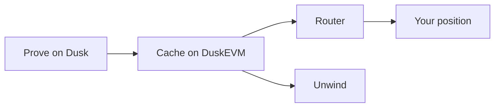

# Concepts

A cleared person proves it on Dusk. DuskEVM keeps the latest answer, and the router reads that answer before it opens or grows a position. When the answer expires or a revoke arrives, the position can be unwound.

## Two chains

Dusk holds the credential, the session, and the decision to revoke. DuskEVM holds the credit market, the tokens, and a cache of the latest clearance. The bridge carries that clearance one way. The market contract, Morpho Blue, has no clearance logic of its own. The contracts around it do.

## The cache

The cache is one row per linked wallet: whether Latch last said the wallet was cleared, and when that message arrived. Only the native gate configured for this deployment can write the row.

A yes expires. After the freshness window, the cache treats the wallet as uncleared until a new yes arrives. A missing message has the same result as a revoke.

## The fence

The tokens in a Lien market only move along an allowlist.

A cleared wallet can send collateral or the loan token to the market or to the router. The market, the router, the liquidator, and the sweep address can send those tokens among themselves, and back to a cleared wallet on a withdrawal. A wallet cannot send them to another wallet.

The router is the entry the product supports. It asks the cache before supply, collateral, or borrow, and it opens the position in the caller's name. The router does not keep the position.

An admin grants who may mint, and which addresses count as the market side or the user side. A market is fixed when it is created: loan token, collateral token, price source, interest model, and liquidation threshold. The router chooses which of those existing markets it will forward into.

## The price

Morpho asks its price contract for a number. Lien answers through a thin adapter. On testnet an admin sets that number. The adapter is the slot a published mark later fills, so the market itself stays as it was created.

## Revoke and unwind

Clearance has to keep holding while a position is open. A revoke from Latch, or a yes that has aged past the freshness window, marks the wallet uncleared.

The router can be paused. Pause stops new supply, new collateral, and new borrow. Unwind still runs.

Unwind liquidates that person's Morpho position. Seized collateral and returned loan tokens sit with the router until an admin sweeps them to an allowlisted address.

A separate break-glass key can mark a wallet uncleared on the cache directly, when the bridge has not delivered the revoke yet.

## What a reader should expect

The bridge can be slow. The freshness window, pause, and the break-glass key bound how long a stale yes still counts.

Balances and transfers on DuskEVM are public. The credential and the proof stay on Dusk. The EVM cache stores the result and the time, not the credential.
