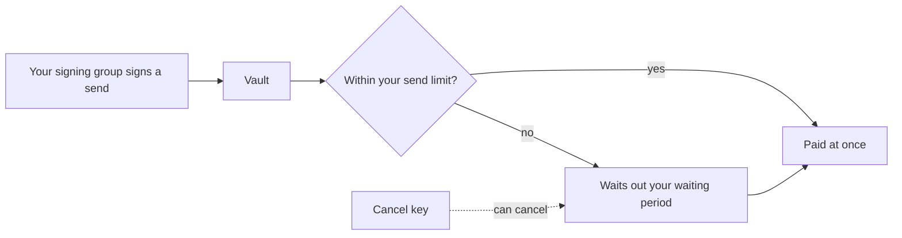

# Vigil

A vault for DUSK where large sends wait and a cancel key can cancel them. If someone gets your key, a plain wallet can be emptied in one transaction. In a Vigil vault a small send leaves at once, within a limit you set, and a large send waits so that you can cancel it. You can stake from the same vault, and the node's consensus key never has to live in it.

**Status:** testnet · not audited. Vigil runs on Dusk testnet through its desktop app as a downloadable testnet binary.

## How one action moves

Your signing group approves a send on its own computers. A send that fits your send limit is paid at once. Anything larger waits out your waiting period and is announced, and your cancel key can cancel it before it settles. The signing group is provided by [Knot](/v1/knot/).

## Five things to know before you rely on it

1. **Testnet only, and not audited.** No outside review has been published. Don't use mainnet keys with Vigil.
2. **Small sends cannot be stopped.** Within your send limit a send leaves at once, and nobody can cancel it. The limit is what bounds a thief who holds enough of your keys. Set it to what you can afford to lose.
3. **Lose both the signing group and the cancel key, and the vault cannot act.** The cancel key is your way back when the group is lost. Keep it on other media, never on the computer that signs.
4. **A key on a hacked computer is exposed.** If one computer in your signing group is compromised, an attacker can move up to your send limit at once. Keep the cancel key off that computer.
5. **Whoever runs the vault's software updates can change how it behaves.** They cannot pay out anything your group did not sign, but they can get in your way. [Security](./security) lists what holds and what does not.

## What you can do with it

| You want to | Read |
|---|---|
| Open a vault on testnet with the desktop app | [Quickstart](./quickstart) |
| Understand the waiting period, the cancel key and send limits | [Concepts](./concepts) |
| Know what holds against each threat, and what does not | [Security](./security) |
| Send, stake, cancel a send or replace a key in the app | [Desktop](./desktop) |
| Know what each action costs | [Costs and fees](./costs) |
| Look up a term | [Glossary](./glossary) |

## Try it

The app is a downloadable testnet app for macOS and Linux. Get it from the [Vigil releases page](https://github.com/Nocturne-Standards/vigil/releases). Follow the [Quickstart](./quickstart) to install it and open a vault on testnet.

## Next

- [Quickstart](./quickstart), then [Concepts](./concepts) and [Security](./security)
- [Deployments](/v1/deployments/): where a product release is recorded
